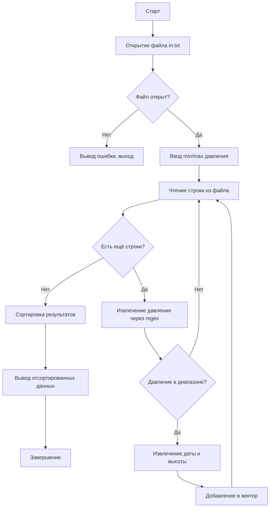

# 📊 Oppo — Анализатор данных атмосферного давления

> **C++ приложение для фильтрации и сортировки метеорологических измерений**

---

## 📋 Оглавление

- [О проекте](#-о-проекте)
- [Возможности](#-возможности)
- [Технологии](#-технологии)
- [Структура проекта](#-структура-проекта)
- [Формат входных данных](#-формат-входных-данных)
- [Инструкция по сборке и запуску](#-инструкция-по-сборке-и-запуску)
- [Пример использования](#-пример-использования)
- [Алгоритм работы](#-алгоритм-работы)
- [Обработка ошибок](#-обработка-ошибок)

---

## 🔍 О проекте

**Oppo** — это консольное приложение на C++, предназначенное для обработки данных метеорологических измерений. Программа читает файл с записями о давлении, высоте и дате измерения, фильтрует данные по заданному диапазону давления и выводит отсортированные результаты.

Проект может быть полезен для:
- 🎓 Учебных целей (работа с файлами, регулярными выражениями, STL)
- 🔬 Прототипирования инструментов анализа метеоданных
- 💻 Изучения обработки неструктурированных текстовых данных

---

## ✨ Возможности

| Функция | Описание |
|---------|----------|
| 🔎 Фильтрация по давлению | Пользователь задаёт минимальное и максимальное значение давления (мм рт. ст.) |
| 📅 Парсинг дат | Извлечение дат в формате `ГГГГ.ММ.ДД` с помощью регулярных выражений |
| 📏 Обработка высоты | Поддержка дробных значений высоты в метрах |
| 🔢 Сортировка | Двухуровневая сортировка: сначала по давлению, затем по высоте (по возрастанию) |
| 🛡️ Обработка ошибок | Корректная обработка некорректных строк и исключений |
| 📁 Работа с файлами | Чтение данных из файла `in.txt`, вывод результатов в консоль |

---

## 🛠️ Технологии

- **Язык**: C++ (стандарт C++11 и выше)
- **Библиотеки STL**:
  - `<iostream>`, `<fstream>` — ввод/вывод
  - `<string>`, `<vector>` — работа со строками и коллекциями
  - `<regex>` — регулярные выражения
  - `<algorithm>` — сортировка
  - `<stdexcept>` — обработка исключений
- **Среда сборки**: Visual Studio (файлы `.sln`, `.vcxproj`)
- **Совместимость**: Windows / Linux / macOS (при наличии компилятора с поддержкой C++11)

---

## 📁 Структура проекта

```
Oppo/
├── Oppo_work.cpp          # Исходный код программы
├── in.txt                 # Файл с входными данными
├── Oppo_work.sln          # Решение Visual Studio
├── Oppo_work.vcxproj      # Проект Visual Studio
├── .gitignore             # Исключения для Git
└── README.md              # Документация (этот файл)
```

---

## 📥 Формат входных данных

Файл `in.txt` содержит строки с измерениями в **произвольном порядке** полей. Каждая строка должна содержать:

| Поле | Формат | Пример |
|------|--------|--------|
| 📅 Дата | `ГГГГ.ММ.ДД` | `2023.10.31` |
| 📏 Высота | Дробное число (метры) | `150.5` |
| 🌡️ Давление | Целое число (мм рт. ст.) | `750` |

### Примеры допустимых строк:
```
150.5 750 2023.10.31
2024.01.01 200.3 765
2022.12.25 100.7 755
```

> ⚠️ **Важно**: Порядок следования полей в строке может быть произвольным. Программа использует регулярные выражения для извлечения значений независимо от их позиции.

---

## 🚀 Инструкция по сборке и запуску

### ▶️ Вариант 1: Visual Studio (Windows)

1. Откройте файл `Oppo_work.sln` в Visual Studio
2. Выберите конфигурацию `Release` или `Debug`
3. Нажмите `Ctrl+Shift+B` для сборки
4. Убедитесь, что файл `in.txt` находится в рабочей директории
5. Запустите программу (`Ctrl+F5`)

### ▶️ Вариант 2: Компиляция через g++ (Linux/macOS/Windows)

```bash
# Компиляция с поддержкой C++11
g++ -std=c++11 -o oppo Oppo_work.cpp

# Запуск программы
./oppo
```

### ▶️ Вариант 3: CMake (универсальный)

```bash
# Создайте CMakeLists.txt (при необходимости)
mkdir build && cd build
cmake ..
make
./oppo
```

---

## 💡 Пример использования

```
Enter minimum pressure: 750
Enter maximum pressure: 770
```

### 🔽 Вывод программы (отсортированные данные):
```
Date: 2022.12.25, Height: 100.7 m, Pressure: 755 mmHg
Date: 2023.10.31, Height: 150.5 m, Pressure: 750 mmHg
Date: 2024.06.17, Height: 500.3 m, Pressure: 755 mmHg
Date: 2023.11.01, Height: 100.2 m, Pressure: 770 mmHg
...
```

> ✅ Выводятся только записи, где давление находится в диапазоне [750; 770], отсортированные сначала по давлению, затем по высоте.

---

## ⚙️ Алгоритм работы



### 🔑 Ключевые функции:

| Функция | Назначение |
|---------|-----------|
| `extractData()` | Извлечение подстроки по регулярному выражению |
| `comparePressureData()` | Компаратор для сортировки (давление → высота) |
| `operator<<` | Перегрузка вывода для структуры `PressureData` |
| `main()` | Основная логика: чтение, фильтрация, сортировка, вывод |

---

## ⚠️ Обработка ошибок

Программа корректно обрабатывает следующие ситуации:

| Ошибка | Реакция программы |
|--------|------------------|
| ❌ Файл `in.txt` не найден | Вывод сообщения в `cerr`, код возврата `1` |
| ❌ Некорректный формат числа | Сообщение об ошибке с указанием проблемной строки |
| ❌ Значение вне диапазона `double/int` | Обработка `out_of_range`, пропуск строки |
| ❌ Отсутствие совпадений в regex | Пропуск строки без прерывания выполнения |

> 💡 Все ошибки выводятся в поток `stderr`, не прерывая обработку остальных данных.

---

## 📄 Лицензия

Проект распространяется без явной лицензии. Для коммерческого использования свяжитесь с автором.
